

# Ranajit Baran Chowdhury · QA Automation Portfolio

### 37 public repositories, each with its own test suite running in GitHub Actions: web, mobile, API and full-stack, in Java, Python, JavaScript and TypeScript

[GitHub](https://github.com/rbchy) · [LinkedIn](https://www.linkedin.com/in/rbchy/) · [Website](https://rbchy.github.io/rbchy/) (installable app: Android, iPhone, desktop) · [Portfolio](https://rbc6543.wixsite.com/rbc-portfolio) · [chyranajit@gmail.com](mailto:chyranajit@gmail.com)

Test automation across **web, mobile and API** with **Selenium, Playwright, Cypress, Appium, REST Assured, Postman, Cucumber and Behave**. Each of the 35 code repositories has a GitHub Actions pipeline that builds the project and runs its tests on every push. This portfolio and the profile site (rbchy) check themselves too, which makes 37 pipelines, all green. That is **5,216 automated tests**, counted per repository. Several suites run on real infrastructure: a MySQL 8 service, an Android 13 emulator, or three browsers.

The flagship is a complete test system around an online store: **1,489 tests behind 18 CI quality gates**. Its code now runs **[RbcTcsWorld Shop](https://github.com/rbchy/RbcTcsWorld)** (2,039 tests, 19 gates) on its way to a live store: first an Amazon affiliate site, later its own shop. Behind it are four decades of enterprise systems work, from container terminal management (NAVIS SPARCS N4) to GMP pharmaceutical packaging.

> *"Quality is never an accident; it is always the result of intelligent effort."*

---

## 🚦 Portfolio Status Board

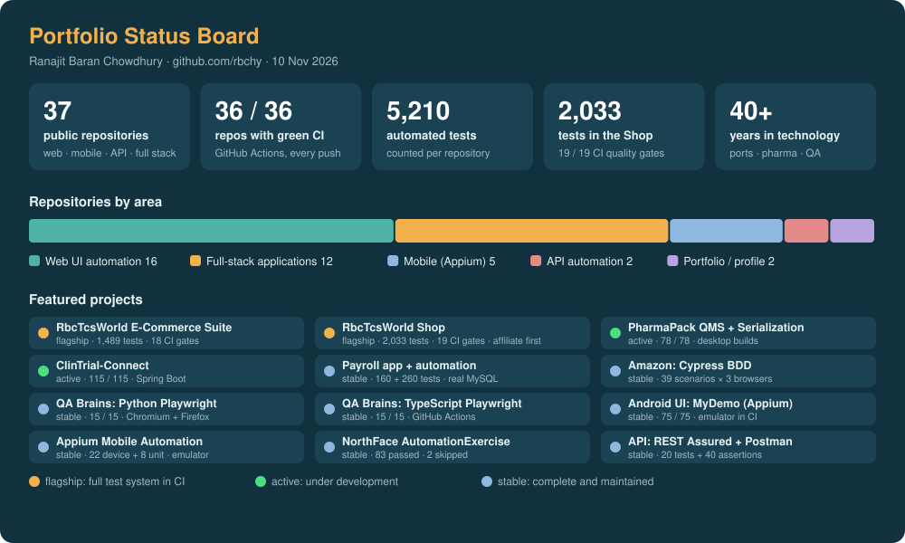

The cards are drawn from [`docs/portfolio.json`](docs/portfolio.json) (one entry per repository, 10 Nov 2026) by [`docs/images/make_readme_cards.py`](docs/images/make_readme_cards.py). The CI badges in this README are live.

## 📈 GitHub Stats

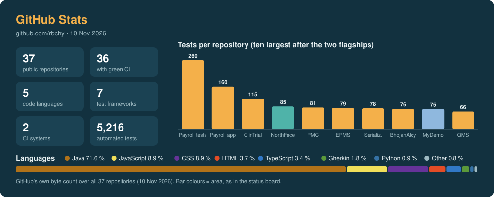

---

## 🛠️ November 2026: every repository tested in CI

Between 9 and 10 November every repository was brought under the same rule: **the code is checked against its README, real bugs are fixed with a test that can fail, a GitHub Actions pipeline must be green, and the README is rewritten from what CI actually shows.** Some of what that work found:

| Repository | Found and fixed |
|---|---|
| [PayrollManagementSystem](https://github.com/rbchy/PayrollManagementSystem) | the project **did not compile** (5 classes defined twice); the JAR pointed at a main class that does not exist; *Update Employee* used 4 non-existent columns |
| [Payroll automation](https://github.com/rbchy/PayrollManagementSystems_Automation_Java_MySql_Selenium) | the same *Update* SQL bug, proven on a real MySQL; cheque line `… AND 00/100`; `mvn verify` failed after the tests |
| [Amazon Cypress](https://github.com/rbchy/Amazon-Cypress-JavaScript-Automation) | the code was not on GitHub at all; filter, sort and cart steps could never fail. Now a stateful mock, and a mutation check proves the steps catch bugs |
| [AppiumMobileAutomation](https://github.com/rbchy/AppiumMobileAutomation) | only an `assertTrue(true)` test ran; page dumps went to a laptop-only `/Users/...` path; emulator run found below-the-fold controls |
| [QA Brains Python](https://github.com/rbchy/QaBrainsAutomationPythonPlawright) | placeholder steps (`assert True`), always-headed browser; now Chromium + Firefox, with logged recovery from the live site's own crash screen |
| [WebdriverIO demo app](https://github.com/rbchy/WebdriverIO-Native-DemoApp-MobileTestAutomationJavaAppiumTestNG) | Appium 2 / driver 4 mismatch, wrong locators, login fields leaking between tests |
| [BhojanAloy POS](https://github.com/rbchy/BhojanAloy-Food-Coffee-Shop-POS-System) | schema missing the recipe columns; colliding order numbers |
| [NorthFace](https://github.com/rbchy/NorthFace_AutomationExercise-BDD-Test-Automation) · [AmazonSeleniumTest](https://github.com/rbchy/AmazonSeleniumTest) | money rounding, a price parser crash; bot walls are now reported as *skipped, with the reason*, never bypassed |
| [E-Commerce Suite](https://github.com/rbchy/RbcTcsWorld_ECommerceSuite) | vulnerable dependencies upgraded until OSV-Scanner reports 0 |
| [RbcTcsWorld Shop](https://github.com/rbchy/RbcTcsWorld) | Playwright 1.56 no longer installed on the new Ubuntu runner; a flaky photo-upload test traced to the server's *429 busy* answer (DEF-031, fixed with Retry-After handling) |
| [rbchy (profile site)](https://github.com/rbchy/rbchy) | the daily *profile summary cards* job had failed on all 46 runs (no `actions/checkout`); new site checks keep README, website (6 languages) and resume in line with the data |

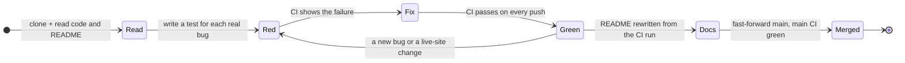

---

## 🥧 Breakdown

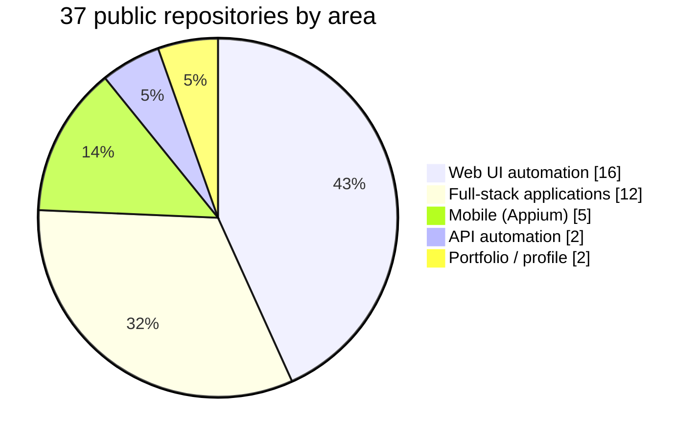

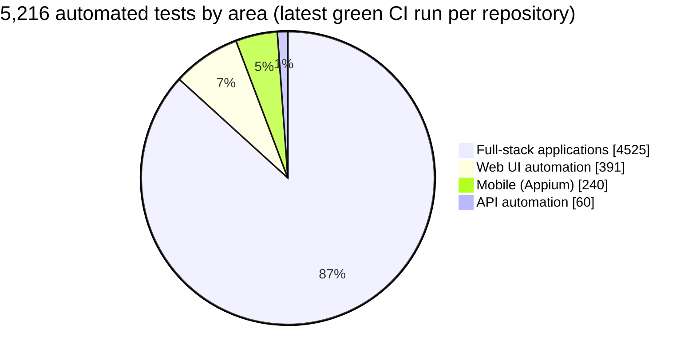

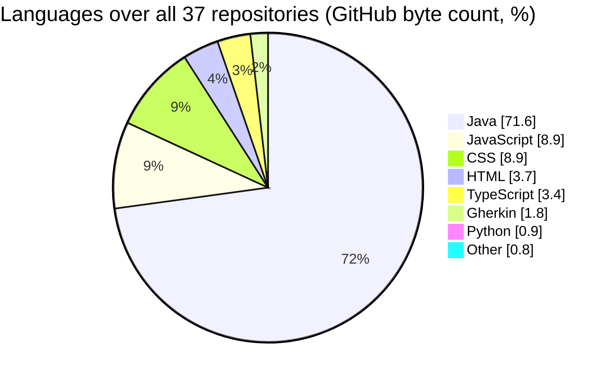

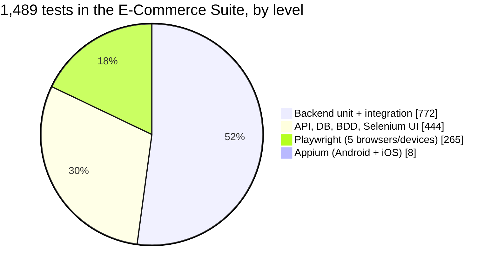

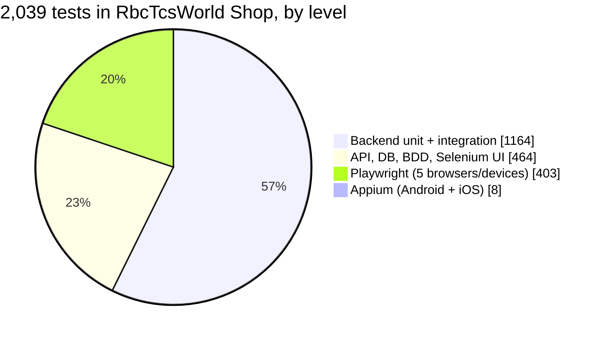

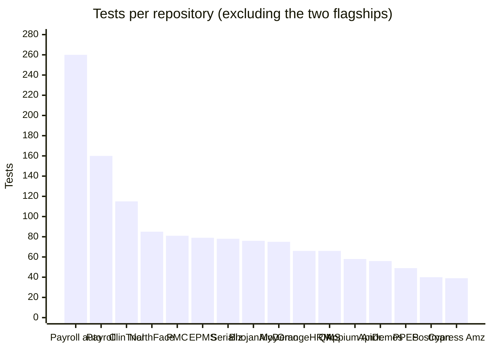

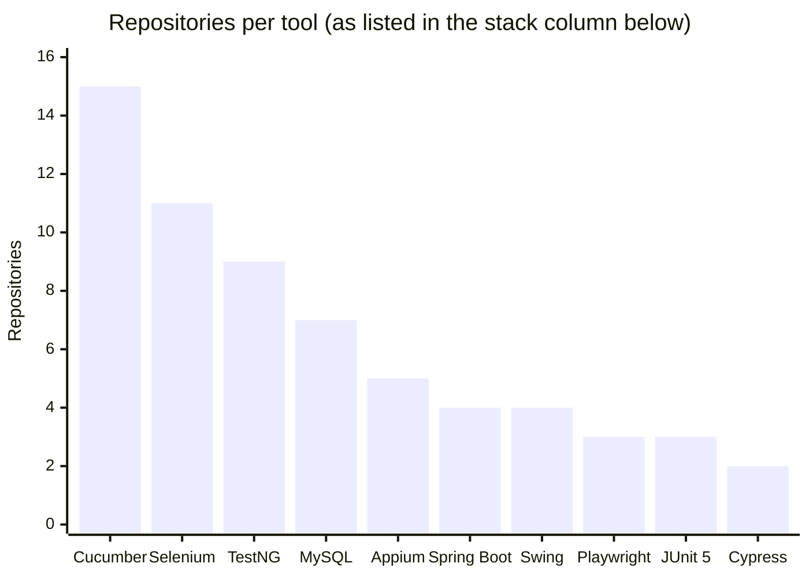

---

## 🗺️ How the portfolio fits together

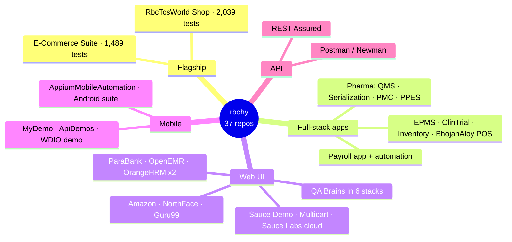

### What is tested, and with what

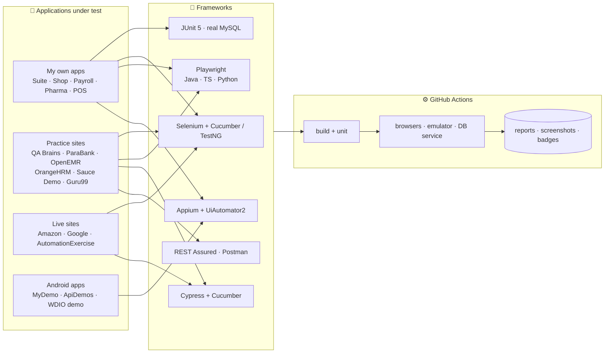

### The pipeline pattern every repository follows

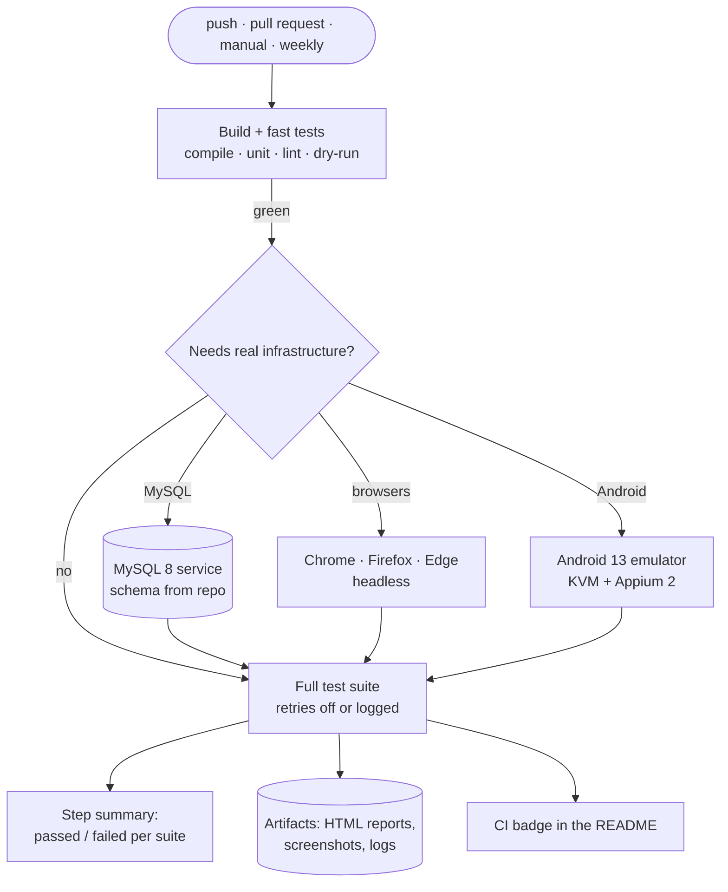

### Framework layers (shared by the UI suites)

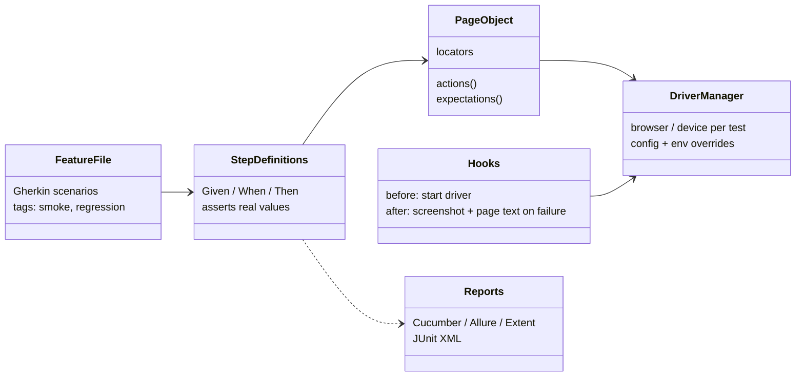

### One push, end to end

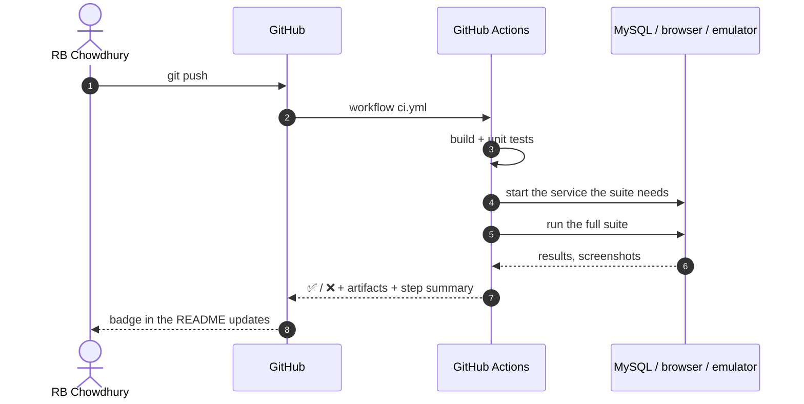

---

## ⏱️ Reviewing this in 5 minutes

1. **The flagship:** [RbcTcsWorld E-Commerce Suite](https://github.com/rbchy/RbcTcsWorld_ECommerceSuite). The application is the test object; the work is the test system around it. Start with its README and the [live reports](https://rbchy.github.io/RbcTcsWorld_ECommerceSuite/reports/).
2. **Defects the tests actually found:** [29 defect reports](https://github.com/rbchy/RbcTcsWorld_ECommerceSuite/blob/main/docs/qa/DEFECT_REPORTS.md), each with evidence, root cause, fix and regression test.
3. **How release decisions are made:** [Test Strategy](https://github.com/rbchy/RbcTcsWorld_ECommerceSuite/blob/main/docs/qa/TEST_STRATEGY.md) · [Risk Register](https://github.com/rbchy/RbcTcsWorld_ECommerceSuite/blob/main/docs/qa/RISK_REGISTER.md) · [Traceability (129 requirements)](https://github.com/rbchy/RbcTcsWorld_ECommerceSuite/blob/main/docs/qa/TRACEABILITY_MATRIX.md) · [UAT Plan](https://github.com/rbchy/RbcTcsWorld_ECommerceSuite/blob/main/docs/qa/UAT_PLAN.md)
4. **From portfolio to live store:** [RbcTcsWorld Shop](https://github.com/rbchy/RbcTcsWorld) and its [roadmap](https://github.com/rbchy/RbcTcsWorld/blob/main/docs/store/ROADMAP.md):
   - integrations: Stripe Elements, Stripe Tax, Shippo, Amazon SES, and a production stack with tested backups
   - 26 decision records and 163 traced requirements
   - it goes live first as an Amazon affiliate site ([ADR-0026](https://github.com/rbchy/RbcTcsWorld/blob/main/docs/adr/0026-partner-only-site.md))
5. **One site, six stacks:** QA Brains in [Python](https://github.com/rbchy/QaBrainsAutomationPythonPlawright), [TypeScript](https://github.com/rbchy/QaBrainsAutomationTypeScriptPlaywright), [Java Playwright](https://github.com/rbchy/QaBrainsAutomationJavaPlaywright), [Java Selenium](https://github.com/rbchy/QaBrainsAutomationJavaSelenium), [Cypress](https://github.com/rbchy/QaBrainsAutomationCypressJavaScript) and [Sauce Labs](https://github.com/rbchy/QaBrainsSauceLabAPI_Automation).
6. **Mobile on a real emulator in CI:** [MyDemo](https://github.com/rbchy/AndroidUIAppiumTest_MyDemoEcommerce) (75 tests) and [AppiumMobileAutomation](https://github.com/rbchy/AppiumMobileAutomation) boot an Android 13 emulator on every push.
7. **Domain depth:** [PharmaPack QMS + Serialization](https://github.com/rbchy/RbcTcsWorld_PharmaPackQMS_Serialization) (GMP packaging, from my work as a pharmaceutical packaging Line Lead).

---

## ⭐ Flagship projects

| Project | What it is | Evidence |
|---|---|---|
| [RbcTcsWorld E-Commerce Suite](https://github.com/rbchy/RbcTcsWorld_ECommerceSuite) | Amazon-inspired store (Java 21, Spring Boot 4.1, PostgreSQL, React) built to be tested: unit, API, contract, DB, BDD, Selenium, Playwright, Appium, accessibility, performance, security, mutation testing |     |
| [RbcTcsWorld Shop](https://github.com/rbchy/RbcTcsWorld) | The suite's code on its way to a real store: Stripe Elements, Stripe Tax, Shippo labels and returns, Amazon SES, backups, legal pages, Amazon partner products; an affiliate site first, the own shop later |      |

---

## 📂 Projects by area

Every row comes from [`docs/portfolio.json`](docs/portfolio.json). The CI column shows each repository's live GitHub Actions badge.

<!-- projects:start -->

### 💻 Full-stack applications (each tested in CI) · 12 repositories · 4,525 tests

| Project | Stack | Latest CI result | CI |
|---|---|---|---|
| [RbcTcsWorld](https://github.com/rbchy/RbcTcsWorld) ⭐ | Java 21 · Spring Boot · PostgreSQL · React · Stripe · Shippo · SES | 2,039 tests · 19 / 19 gates · 0 flaky |  |
| [RbcTcsWorld\_ECommerceSuite](https://github.com/rbchy/RbcTcsWorld_ECommerceSuite) ⭐ | Java 21 · Spring Boot 4.1 · PostgreSQL · React | 1,489 tests · 18 / 18 gates |  |
| [PayrollManagementSystems\_Automation\_Java\_MySql\_Selenium](https://github.com/rbchy/PayrollManagementSystems_Automation_Java_MySql_Selenium) | Java 21 · Swing · MySQL · JUnit 5 · Cucumber · AssertJ-Swing | 260 / 260 · real MySQL |  |
| [PayrollManagementSystem](https://github.com/rbchy/PayrollManagementSystem) | Java 21 · Swing · MySQL · JUnit 5 | 160 / 160 · real MySQL |  |
| [RbcTcsWorld\_ClinTrial-Connect](https://github.com/rbchy/RbcTcsWorld_ClinTrial-Connect) | Spring Boot · JMeter | 115 / 115 |  |
| [RbcTcsWorld\_Pharmaceuticals\_PMC](https://github.com/rbchy/RbcTcsWorld_Pharmaceuticals_PMC) | Java · Swing · MySQL | 81 / 81 |  |
| [RbcTcsWorld-EPMS](https://github.com/rbchy/RbcTcsWorld-EPMS) | Spring Boot REST API · MySQL | 79 / 79 |  |
| [RbcTcsWorld\_PharmaPackQMS\_Serialization](https://github.com/rbchy/RbcTcsWorld_PharmaPackQMS_Serialization) | Java · desktop builds (Windows, macOS, Linux) | 78 / 78 |  |
| [BhojanAloy-Food-Coffee-Shop-POS-System](https://github.com/rbchy/BhojanAloy-Food-Coffee-Shop-POS-System) | Java Swing · MySQL | 76 / 76 |  |
| [RbcTcsWorld\_PharmaPackQMS](https://github.com/rbchy/RbcTcsWorld_PharmaPackQMS) | Java · GMP packaging QMS | 66 / 66 |  |
| [PPES-Pharmaceutical-Packaging-Management](https://github.com/rbchy/PPES-Pharmaceutical-Packaging-Management) | Java 17 · MySQL 8 · DAO / MVC | 49 / 49 |  |
| [InventoryControlManagement\_JavaMySql](https://github.com/rbchy/InventoryControlManagement_JavaMySql) | Java 17 · MySQL 8 · JDBC | 33 / 33 |  |

### 🌐 Web UI automation (BDD) · 16 repositories · 391 tests

| Project | Stack | Latest CI result | CI |
|---|---|---|---|
| [NorthFace\_AutomationExercise-BDD-Test-Automation](https://github.com/rbchy/NorthFace_AutomationExercise-BDD-Test-Automation) | Java · Selenium · Cucumber · API · a11y · perf | 83 passed · 2 skipped (bot wall) |  |
| [OrangeHRM\_TestAutomation\_TestNG\_Junit5](https://github.com/rbchy/OrangeHRM_TestAutomation_TestNG_Junit5) | Java · Selenium · TestNG · JUnit 5 | 66 / 66 |  |
| [Amazon-Cypress-JavaScript-Automation](https://github.com/rbchy/Amazon-Cypress-JavaScript-Automation) | JavaScript · Cypress 14 · Cucumber | 39 / 39 × Chrome · Firefox · Edge |  |
| [Guru99TelTest](https://github.com/rbchy/Guru99TelTest) | Java · Selenium · TestNG | 29 / 29 |  |
| [ParaBank-BankingAutomationJavaSelenium](https://github.com/rbchy/ParaBank-BankingAutomationJavaSelenium) | Java · Selenium · Cucumber | 20 / 20 |  |
| [AmazonSeleniumTest](https://github.com/rbchy/AmazonSeleniumTest) | Java · Selenium · Cucumber | 19 / 19 unit · live runs skip on bot wall |  |
| [Multicart\_Demo\_Automation](https://github.com/rbchy/Multicart_Demo_Automation) | Java · Selenium · Cucumber | 17 / 17 |  |
| [Sauce-Demo.MyShopify.AutomationTest](https://github.com/rbchy/Sauce-Demo.MyShopify.AutomationTest) | Java · Selenium · Cucumber | 17 / 17 |  |
| [QaBrainsAutomationPythonPlawright](https://github.com/rbchy/QaBrainsAutomationPythonPlawright) | Python · Playwright · Behave | 15 / 15 × Chromium · Firefox |  |
| [QaBrainsAutomationTypeScriptPlaywright](https://github.com/rbchy/QaBrainsAutomationTypeScriptPlaywright) | TypeScript · Playwright · Cucumber.js | 15 / 15 |  |
| [QaBrainsAutomationJavaPlaywright](https://github.com/rbchy/QaBrainsAutomationJavaPlaywright) | Java · Playwright · Cucumber · TestNG | 15 / 15 |  |
| [QaBrainsAutomationJavaSelenium](https://github.com/rbchy/QaBrainsAutomationJavaSelenium) | Java · Selenium · Cucumber · TestNG | 15 / 15 |  |
| [QaBrainsAutomationCypressJavaScript](https://github.com/rbchy/QaBrainsAutomationCypressJavaScript) | JavaScript · Cypress · Cucumber | 15 / 15 |  |
| [QaBrainsSauceLabAPI\_Automation](https://github.com/rbchy/QaBrainsSauceLabAPI_Automation) | Java · Selenium · Cucumber · Sauce Labs | 15 / 15 headless |  |
| [OrangeHRM\_Automation](https://github.com/rbchy/OrangeHRM_Automation) | Java · Selenium · Cucumber | 5 / 5 |  |
| [OpenEMR\_Automation](https://github.com/rbchy/OpenEMR_Automation) | Java · Selenium · Cucumber | 4 / 4 |  |

### 📱 Mobile (Appium, Android emulator in CI) · 5 repositories · 240 tests

| Project | Stack | Latest CI result | CI |
|---|---|---|---|
| [AndroidUIAppiumTest\_MyDemoEcommerce](https://github.com/rbchy/AndroidUIAppiumTest_MyDemoEcommerce) | Java 17 · Appium · UiAutomator2 · TestNG | 75 / 75 · emulator |  |
| [AppiumTest\_Andriod\_Automation](https://github.com/rbchy/AppiumTest_Andriod_Automation) | Java · Appium · TestNG | 55 passed · 3 skipped · emulator |  |
| [AppiumAutomation\_ApiDemos](https://github.com/rbchy/AppiumAutomation_ApiDemos) | Java 17 · Appium 3 · TestNG | 56 / 56 · emulator |  |
| [AppiumMobileAutomation](https://github.com/rbchy/AppiumMobileAutomation) | Java · Appium 2 · TestNG · Allure | 22 device + 8 unit · emulator |  |
| [WebdriverIO-Native-DemoApp-MobileTestAutomationJavaAppiumTestNG](https://github.com/rbchy/WebdriverIO-Native-DemoApp-MobileTestAutomationJavaAppiumTestNG) | Java · Appium 2 · TestNG | 21 / 21 · emulator |  |

### 🔌 API testing · 2 repositories · 60 tests

| Project | Stack | Latest CI result | CI |
|---|---|---|---|
| [QaBrainsAPIAutomation\_Postman](https://github.com/rbchy/QaBrainsAPIAutomation_Postman) | Postman · Newman | 40 / 40 assertions |  |
| [QaBrainsAPIAutomationRestAssured](https://github.com/rbchy/QaBrainsAPIAutomationRestAssured) | Java · REST Assured · Cucumber | 5 API + 15 UI |  |

### 🪪 Portfolio and profile · 2 repositories

| Project | Stack | Latest CI result | CI |
|---|---|---|---|
| [rbchy](https://github.com/rbchy/rbchy) | GitHub profile · website · installable app | site, i18n and README checks |  |
| [ranajitchowdhury](https://github.com/rbchy/ranajitchowdhury) | this portfolio | README checks |  |

<!-- projects:end -->

---

## 🛠️ Skills

| Area | Tools |
|---|---|
| Languages | Java · Python · TypeScript · JavaScript · SQL |
| Web UI | Selenium 4 · Playwright · Cypress · Page Object Model |
| Mobile | Appium 2 / 3 · UiAutomator2 (Android) · XCUITest (iOS) · Android emulator in CI |
| BDD and runners | Cucumber · Behave · TestNG · JUnit 5 · pytest |
| API | REST Assured · Postman / Newman · JSON Schema contracts · OpenAPI diff |
| Quality engineering | JaCoCo coverage · PIT mutation testing · axe-core accessibility · k6 / JMeter performance · OWASP ZAP · OSV-Scanner |
| CI/CD and delivery | GitHub Actions · Jenkins · Docker / Compose · Maven · npm |
| Reporting | Allure · ExtentReports · Cucumber HTML · Playwright HTML |
| Cloud and data | Sauce Labs · AWS basics · PostgreSQL · MySQL · Oracle · Redis |
| Ways of working | Agile Scrum · SDLC / STLC · risk-based testing · traceability · UAT · Jira |

---

## 👨‍💼 Career

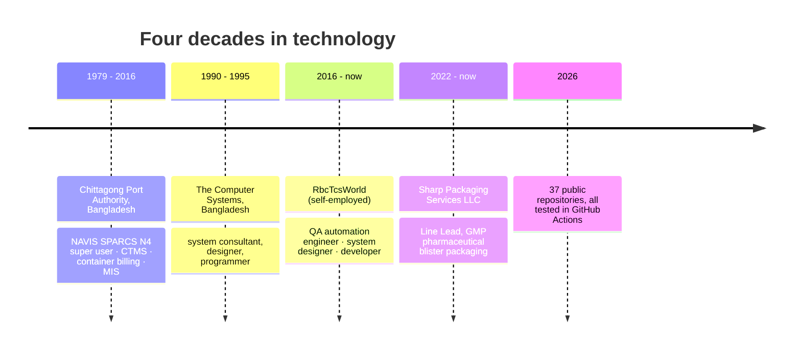

| Years | Role |
|---|---|
| 2022 - present | **Sharp Packaging Services LLC**: Line Lead in pharmaceutical blister packaging (primary and secondary). Leads teams of up to 25 operators; batch records and line clearance, serialization, GMP, FDA regulations, OEB handling |
| 2016 - present | **RbcTcsWorld** (self-employed): QA automation engineer, system designer and developer |
| 1990 - 1995 | **The Computer Systems**, Bangladesh: system consultant, designer and programmer |
| 1979 - 2016 | **Chittagong Port Authority**, Bangladesh: NAVIS SPARCS N4 super user (CTMS configuration, container billing, MIS, team training) |

**Education:** Master's in Public Administration, University of Chittagong (1984-1985).

---

## ⚙️ How this README is kept honest

This repository has its own CI ([`ci.yml`](.github/workflows/ci.yml)). It runs on every push and once a week:

- **Data and tables:** the project tables must match `docs/portfolio.json`, and every number in the cards must add up (areas, tests, CI count).
- **Cards:** `make_readme_cards.py` must redraw exactly the committed SVG cards.
- **Charts:** every Mermaid chart in this README must render.
- **CI for every repo:** each repository listed with a workflow must have a CI badge that GitHub serves.

---

## 📫 Contact

| | |
|---|---|
| Email | [chyranajit@gmail.com](mailto:chyranajit@gmail.com) |
| Location | West Norriton, Pennsylvania 19403, USA · open to remote and hybrid |
| Phone | +1 (267) 342-5565 |
| LinkedIn | [linkedin.com/in/rbchy](https://www.linkedin.com/in/rbchy/) |
| GitHub | [github.com/rbchy](https://github.com/rbchy) |
| Website | [rbchy.github.io/rbchy](https://rbchy.github.io/rbchy/) · [Wix portfolio](https://rbc6543.wixsite.com/rbc-portfolio) |
| App | Open the website and press **Install app** (Android, Windows, Mac), or on iPhone use Safari → *Add to Home Screen*. Works offline · [Android build](https://github.com/rbchy/rbchy/actions/workflows/android-app.yml) |

**Available for:** full-time · contract · freelance QA Automation Engineer / SDET roles.

---

No portfolio proves a tester is good. This one shows the work instead: frameworks built from scratch, tests that found real defects, and a green CI run behind every number.
