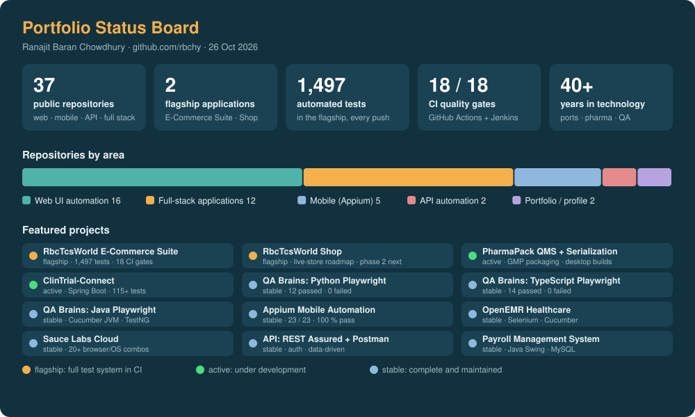
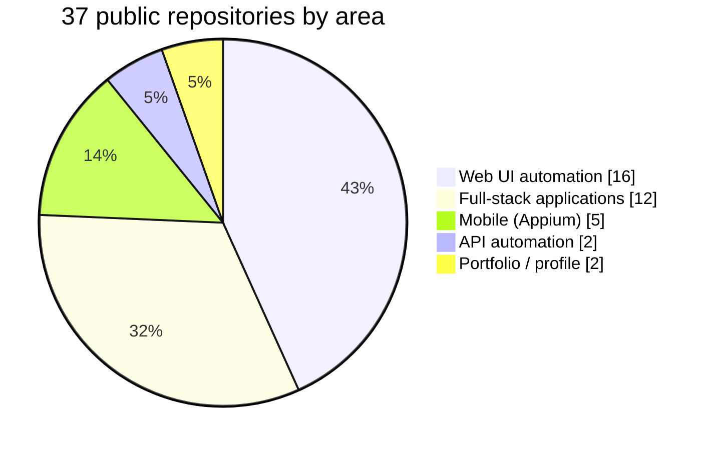
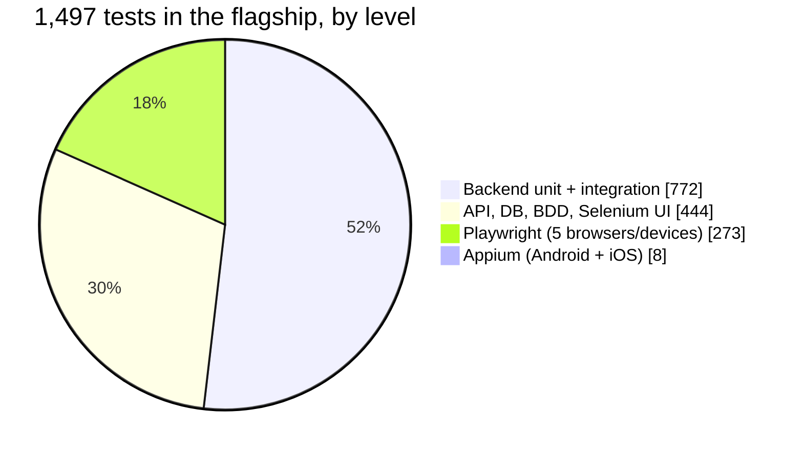
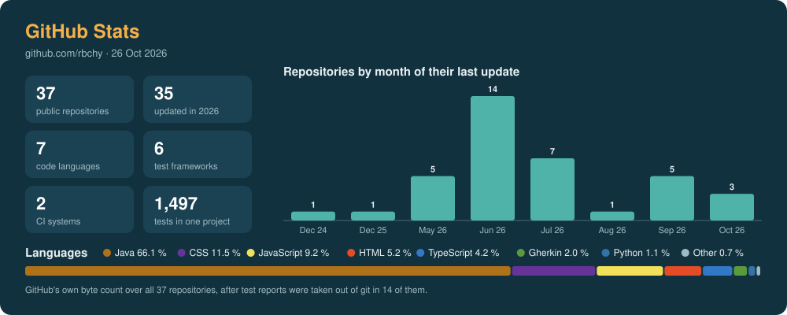

# Ranajit Baran Chowdhury - QA Automation Portfolio

Test automation across **web, mobile and API**, in **Java, Python, JavaScript and TypeScript**, with **Selenium,
Playwright, Cypress, Appium, REST Assured, Postman and Cucumber**. 37 public repositories: e-commerce, banking,
healthcare, HR, pharmaceutical packaging and cloud testing. The flagship is a complete test system around an online
store: 1,497 automated tests behind 18 CI quality gates in GitHub Actions and Jenkins. Behind it are four decades of
enterprise systems work, from container terminal management (NAVIS SPARCS N4) to GMP pharmaceutical packaging.

Author: **Ranajit Baran (RB) Chowdhury**, QA Automation Engineer / SDET -
[GitHub](https://github.com/rbchy) · [LinkedIn](https://www.linkedin.com/in/rbchy/) ·
[Website](https://rbchy.github.io/rbchy/) · [Portfolio](https://rbc6543.wixsite.com/rbc-portfolio) ·
[chyranajit@gmail.com](mailto:chyranajit@gmail.com)

> *"Quality is never an accident; it is always the result of intelligent effort."*

---

## 🚦 Portfolio Status Board

The board is a snapshot of 26 Oct 2026, redrawn with [`docs/images/make_readme_cards.py`](docs/images/make_readme_cards.py);
the CI badges above are live.

## 🥧 Breakdown

## 📈 GitHub Stats

---

## Reviewing this in 5 minutes

1. **The flagship:** [RbcTcsWorld E-Commerce Suite](https://github.com/rbchy/RbcTcsWorld_ECommerceSuite) - the
   application is the test object; the work is the test system around it. Start with its README and the
   [live reports](https://rbchy.github.io/RbcTcsWorld_ECommerceSuite/reports/).
2. **Defects the tests actually found:** [29 defect reports](https://github.com/rbchy/RbcTcsWorld_ECommerceSuite/blob/main/docs/qa/DEFECT_REPORTS.md),
   each with evidence, root cause, fix and regression test.
3. **How release decisions are made:** [Test Strategy](https://github.com/rbchy/RbcTcsWorld_ECommerceSuite/blob/main/docs/qa/TEST_STRATEGY.md) ·
   [Risk Register](https://github.com/rbchy/RbcTcsWorld_ECommerceSuite/blob/main/docs/qa/RISK_REGISTER.md) ·
   [Traceability (129 requirements)](https://github.com/rbchy/RbcTcsWorld_ECommerceSuite/blob/main/docs/qa/TRACEABILITY_MATRIX.md) ·
   [UAT Plan](https://github.com/rbchy/RbcTcsWorld_ECommerceSuite/blob/main/docs/qa/UAT_PLAN.md)
4. **From portfolio to live store:** [RbcTcsWorld Shop](https://github.com/rbchy/RbcTcsWorld) and its
   [roadmap](https://github.com/rbchy/RbcTcsWorld/blob/main/docs/store/ROADMAP.md).
5. **One framework, three languages:** QA Brains in [Python](https://github.com/rbchy/QaBrainsAutomationPythonPlawright),
   [TypeScript](https://github.com/rbchy/QaBrainsAutomationTypeScriptPlaywright) and
   [Java](https://github.com/rbchy/QaBrainsAutomationJavaPlaywright) with Playwright.
6. **Domain depth:** [PharmaPack QMS + Serialization](https://github.com/rbchy/RbcTcsWorld_PharmaPackQMS_Serialization)
   (GMP packaging, from my work as a pharmaceutical packaging Line Lead).

---

## ⭐ Flagship projects

| Project | What it is | Evidence |
|---|---|---|
| [RbcTcsWorld E-Commerce Suite](https://github.com/rbchy/RbcTcsWorld_ECommerceSuite) | Amazon-inspired store (Java 21, Spring Boot 4.1, PostgreSQL, React) built to be tested: unit, API, contract, DB, BDD, Selenium, Playwright, Appium, accessibility, performance, security, mutation testing |     |
| [RbcTcsWorld Shop](https://github.com/rbchy/RbcTcsWorld) | The same code on its way to a real store: Stripe Elements, tax, shipping, e-mail domain, backups, legal pages, under the same 18 gates |   |

---

## 📂 Projects by area

Live badges show each repository's last update.

### 📱 Mobile (Appium)

| Project | Stack | Result | Updated |
|---|---|---|---|
| [AppiumMobileAutomation](https://github.com/rbchy/AppiumMobileAutomation) | Java · Appium 3 · TestNG · Allure · Sauce Labs My Demo App | 23 / 23, 100 % pass |  |
| [AppiumAutomation_ApiDemos](https://github.com/rbchy/AppiumAutomation_ApiDemos) | Java · Appium 3.5 · TestNG · ExtentReports | lifecycle, gestures, input |  |
| [AndroidUIAppiumTest_MyDemoEcommerce](https://github.com/rbchy/AndroidUIAppiumTest_MyDemoEcommerce) | Java 17 · Appium 3 · UiAutomator2 · TestNG | Android e-commerce flows |  |
| [WebdriverIO Native Demo App](https://github.com/rbchy/WebdriverIO-Native-DemoApp-MobileTestAutomationJavaAppiumTestNG) | Java · Appium · TestNG · Allure | native app flows |  |

### 🌐 Web UI automation (BDD)

| Project | Stack | Result | Updated |
|---|---|---|---|
| [QA Brains: TypeScript](https://github.com/rbchy/QaBrainsAutomationTypeScriptPlaywright) | TypeScript · Playwright · Cucumber.js | 14 passed, 0 failed |  |
| [QA Brains: Python](https://github.com/rbchy/QaBrainsAutomationPythonPlawright) | Python · Playwright · Behave · Allure | 12 passed, 0 failed |  |
| [QA Brains: Java Playwright](https://github.com/rbchy/QaBrainsAutomationJavaPlaywright) | Java · Playwright · Cucumber JVM · TestNG | stable |  |
| [QA Brains: Java Selenium](https://github.com/rbchy/QaBrainsAutomationJavaSelenium) | Java · Selenium · Cucumber · TestNG | stable |  |
| [Amazon: Cypress](https://github.com/rbchy/Amazon-Cypress-JavaScript-Automation) | JavaScript · Cypress 14 · Cucumber | login, shopping, cart |  |
| [QA Brains: Cypress](https://github.com/rbchy/QaBrainsAutomationCypressJavaScript) | JavaScript · Cypress 13 · Cucumber | e-commerce flows |  |
| [NorthFace AutomationExercise](https://github.com/rbchy/NorthFace_AutomationExercise-BDD-Test-Automation) | UI, E2E, API, accessibility, performance and security in one project | BDD |  |
| [Sauce Demo + MyShopify](https://github.com/rbchy/Sauce-Demo.MyShopify.AutomationTest) | Java · Selenium · TestNG | two shops |  |
| [Multicart Demo](https://github.com/rbchy/Multicart_Demo_Automation) | Java · Selenium · Cucumber | cart and checkout |  |
| [ParaBank (banking)](https://github.com/rbchy/ParaBank-BankingAutomationJavaSelenium) | Java · Selenium · Spring Boot · MySQL | transfers, loans, statements |  |
| [OpenEMR (healthcare)](https://github.com/rbchy/OpenEMR_Automation) | Java · Selenium · Cucumber · TestNG | patients, records, roles |  |
| [OrangeHRM (HR)](https://github.com/rbchy/OrangeHRM_TestAutomation_TestNG_Junit5) | Java · Selenium · TestNG · JUnit 5 | HR and payroll |  |
| [Sauce Labs cloud](https://github.com/rbchy/QaBrainsSauceLabAPI_Automation) | Java · Selenium · Cucumber · Sauce Labs · Jenkins | 20+ parallel browser/OS combinations |  |

### 🔌 API testing

| Project | Stack | Result | Updated |
|---|---|---|---|
| [QA Brains API: REST Assured](https://github.com/rbchy/QaBrainsAPIAutomationRestAssured) | Java · REST Assured · TestNG | auth, data-driven, schema checks |  |
| [QA Brains API: Postman](https://github.com/rbchy/QaBrainsAPIAutomation_Postman) | Postman · Newman | collections, environments, HTML report |  |

### 💻 Full-stack applications

| Project | Stack | Domain | Updated |
|---|---|---|---|
| [PharmaPack QMS + Serialization](https://github.com/rbchy/RbcTcsWorld_PharmaPackQMS_Serialization) | Java · desktop builds for Windows, macOS, Linux | GMP pharmaceutical packaging |  |
| [ClinTrial-Connect](https://github.com/rbchy/RbcTcsWorld_ClinTrial-Connect) | Spring Boot · 115+ automated tests | clinical-trial patient matching |  |
| [EPMS](https://github.com/rbchy/RbcTcsWorld-EPMS) | Spring Boot REST API + test suite | payroll |  |
| [PPES](https://github.com/rbchy/PPES-Pharmaceutical-Packaging-Management) | Java 17 · MySQL 8 · DAO / MVC | packaging inventory |  |
| [Payroll Management System](https://github.com/rbchy/PayrollManagementSystem) | Java Swing · MySQL · JDBC | payroll |  |
| [BhojanAloy POS](https://github.com/rbchy/BhojanAloy-Food-Coffee-Shop-POS-System) | Java Swing · MySQL | food and coffee shop point of sale |  |
| [Inventory Control](https://github.com/rbchy/InventoryControlManagement_JavaMySql) | Java 17 · MySQL 8 · JDBC | real-time inventory |  |

All 37 repositories: [github.com/rbchy?tab=repositories](https://github.com/rbchy?tab=repositories).

---

## 🛠️ Skills

| Area | Tools |
|---|---|
| Languages | Java · Python · TypeScript · JavaScript · SQL |
| Web UI | Selenium 4 · Playwright · Cypress · Page Object Model |
| Mobile | Appium 3 · UiAutomator2 (Android) · XCUITest (iOS) |
| BDD and runners | Cucumber · Behave · TestNG · JUnit 5 |
| API | REST Assured · Postman / Newman · JSON Schema contracts · OpenAPI diff |
| Quality engineering | JaCoCo coverage · PIT mutation testing · axe-core accessibility · k6 / JMeter performance · OWASP ZAP · OSV-Scanner |
| CI/CD and delivery | GitHub Actions · Jenkins · Docker / Compose · Maven · npm |
| Reporting | Allure · ExtentReports · Cucumber HTML · Playwright HTML |
| Cloud and data | Sauce Labs · AWS basics · PostgreSQL · MySQL · Oracle · Redis |
| Ways of working | Agile Scrum · SDLC / STLC · risk-based testing · traceability · UAT · Jira |

---

## 👨‍💼 Career

| Years | Role |
|---|---|
| 2022 - present | **Sharp Packaging Services LLC** - Line Lead, pharmaceutical blister packaging (primary and secondary): teams of up to 25 operators, batch records and line clearance, serialization, GMP, FDA regulations, OEB handling |
| 2016 - present | **RbcTcsWorld** (self-employed) - QA automation engineer, system designer and developer |
| 1990 - 1995 | **The Computer Systems**, Bangladesh - system consultant, designer and programmer |
| 1979 - 2016 | **Chittagong Port Authority**, Bangladesh - NAVIS SPARCS N4 super user: CTMS configuration, container billing, MIS, team training |

**Education:** Master's in Public Administration, University of Chittagong (1984-1985).

---

## 📫 Contact

| | |
|---|---|
| Email | [chyranajit@gmail.com](mailto:chyranajit@gmail.com) |
| Location | West Norriton, Pennsylvania 19403, USA · open to remote and hybrid |
| Phone | +1 (267) 342-5565 |
| LinkedIn | [linkedin.com/in/rbchy](https://www.linkedin.com/in/rbchy/) |
| GitHub | [github.com/rbchy](https://github.com/rbchy) |
| Website | [rbchy.github.io/rbchy](https://rbchy.github.io/rbchy/) · [Wix portfolio](https://rbc6543.wixsite.com/rbc-portfolio) |

**Available for:** full-time · contract · freelance QA Automation Engineer / SDET roles.

---

No portfolio proves a tester is good. This one shows the work instead: frameworks built from scratch, tests that
found real defects, and the evidence behind every number.
